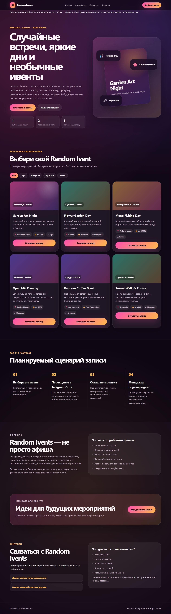

# Random Events Site

A responsive event-catalogue frontend prototype built with HTML, CSS and vanilla JavaScript.

## Overview

This personal web prototype explores presenting event ideas and filtering them by category. The recovered source includes six sample events and a configurable Telegram deep-link pattern.

## Features

- JavaScript-rendered event cards and category filtering.
- Responsive layouts and in-page navigation.
- Configurable Telegram bot links with event slugs as start parameters.
- Sample event dates, locations and prices, clearly labelled as demonstration content.

## Technologies

HTML, CSS and vanilla JavaScript. No dependencies or build tools.

## Project Structure

- `index.html` — page sections and filter controls.
- `styles.css` — layout and visual styling.
- `script.js` — sample event data, rendering, filters and bot-link generation.

## Installation / Running

```powershell
python -m http.server 8001 --bind 127.0.0.1
```

Open `http://127.0.0.1:8001/`. Filter cards using the category buttons. With `BOT_USERNAME` left as `YOUR_BOT_USERNAME`, buttons point to the local contact section. To connect your own existing bot, edit the non-secret username in `script.js`; the bot must implement the deep-link payloads independently.

## Screenshots

Actual local browser capture of the prepared prototype:



## Status

**Prototype.** Event cards and filters are implemented. Registration, Telegram bot processing, Google Sheets storage, payments, admin tools and calendar integration are concepts only; their source is not present. Personal Telegram links have been removed from this portfolio copy.

## Author

Eldar Mukhamedkerimov
